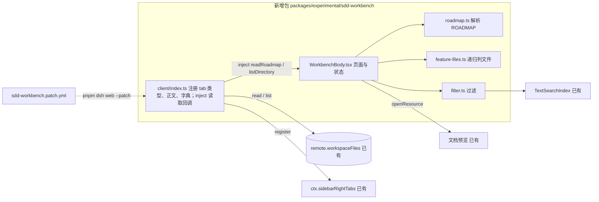
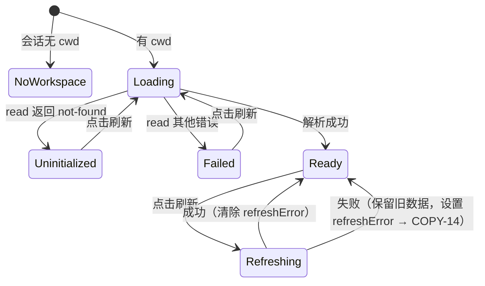

# SDD 工作台：Feature 导航与规格查看 技术方案

> Feature：999 | 有效需求来源：[PRD](../spec/PRD.md)（2026-11-20 版本） | Profile：standard | 模板：`mai-specs/_templates/TECH_DESIGN.tmpl.md` | 代码基线：`feat/sdd-workbench` @ `f524acfb82` | 状态：已评审（有条件通过，F1～F11 已修订，见[评审记录](../review/design_review.md)）

[返回需求简报](../BRIEF.md) · [代码设计附录](CODE_DESIGN.md)

## 需求依据与验收

需求与验收的唯一维护源是 [PRD](../spec/PRD.md)：FR-01～FR-08、BR-01～BR-06、NFR-01～NFR-03、COPY-01～COPY-14、AC-01～AC-09。本文只引用编号，不复述规则。PRD 评审记录见 [prd_review.md](../review/prd_review.md)，方案评审记录见 [design_review.md](../review/design_review.md)。

PRD 留给本阶段的待确认事项及结论：

| PRD 待确认事项 | 结论 | 依据 | 详情 |
|---|---|---|---|
| 插件挂载位置与 README 启动命令 | 实验性 Client 包 + 包内 `--patch` 覆盖文件；启动命令 `pnpm dsh web --patch <包内 patch 文件>` | 见决策 K2 | 1.3 |
| 读取工作区文件的接口 | 复用 `remote.workspaceFiles` 的 `read` 与 `list`，不新增 Host 接口 | `packages/api/workspace-files/README.zh.md` | 2.1.3 |
| 文档预览能否打开任意工作区文件 | 能：`fileAddressFor()` 生成 `dsh-resource://file/…` 地址，`tab.actions.openResource()` 由文档预览认领 | `ui-sidebar-files/src/client/FileNavigator.tsx:258`、`FilesBody.tsx:47`、`ui-sidebar-documentpreview/src/client/definition.ts:50-52` | 2.3.3 |
| 符号链接越界 | Host 已拦截：`list` 跟随符号链接但要求目标在工作区内，`read` 拒绝末端符号链接。中间目录符号链接的残余缺口见风险表 | `api/workspace-files` README“文件读取与目录检查” | 3 |
| 入口图标 | 使用引导页默认占位图标，不新增图形 | 见决策 K5 | 1.3 |

## 1. 方案概述

### 1.1 设计目标和设计原则

- **用户路径**：右侧栏引导页 → SDD 工作台卡片 → 按阶段分组的 Feature 列表 → 展开 Feature → 点击文件 → 文档预览（PRD BF-01）。
- **必做**：PRD FR-01～FR-08；**不做**：PRD 第 7 节“不包含”。
- **硬约束**：
  - 只读（BR-04）：插件只调用 `workspaceFiles.read` 与 `workspaceFiles.list`。
  - 工作区边界（BR-01、NFR-02）：`read` 本身**允许**读工作区外路径，所以插件只读固定的相对路径 `mai-specs/ROADMAP.md`；Feature 目录先在插件内做路径归一化检查，必须位于 `mai-specs/` 之下（PRD BR-05），再交给只能列工作区内目录的 `list`。
  - 仓库规则：
    - 实验性包规则（`packages/experimental/AGENTS.md`）；新插件包清单（`packages/client/AGENTS.md`“New plugin package checklist”）。
    - 界面文案走本地化字典，覆盖全部 8 种发布语言（`scripts/shipped-locales.ts`）。
    - 组件不接触 `ctx`，远程能力经 inject 以回调传入（`packages/client/AGENTS.md`“ctx discipline”）。
    - 列表搜索遵循 Client 搜索规则，用 `TextSearchIndex` 实现（`packages/client/AGENTS.md`“Search and filter”）。
    - 注册通过 `ctx.effect()`，并有卸载后注册项被移除的测试（“Registrations are effects”“Registry contributions prove disposal”）。
    - `src/**` 逐文件 100% 覆盖率（`vitest.config.ts:428-436`）。
- **复用**：右侧栏 tab 注册表与引导页（`ctx.sidebarRightTabs`）、文档预览（经 `openResource` 自动认领）、工作区文件接口（`remote.workspaceFiles`）、文件地址函数（`dsh-util-workspace-path`）、搜索索引（`dsh-util-text-search`）、UI 基础组件（`dsh-client-ui-primitives`）。

### 1.2 整体架构

只新增一个纯 Client 插件包，Host 侧无逻辑（`apply()` 为空，与 `ui-sidebar-files` 相同）。

解析、路径检查、过滤都是不依赖 React 和网络的纯函数，单元测试覆盖 PRD 中大部分 AC；页面组件只负责状态和渲染，读取能力由 `client/index.ts` 在 apply 世界中闭包 `ctx.remote` 后注入，组件测试可直接传桩。

### 1.3 关键决策与 Review 索引

| 决策 | 推荐及理由 | 代价与备选 | 待判断事项/确认状态 | 详情 |
|---|---|---|---|---|
| K1 包位置与名称 | `packages/experimental/sdd-workbench`，包名 `@deepseek-ai/dsh-sdd-workbench`，`private: true`。实验性包无产品支持承诺；按 `packages/experimental/AGENTS.md`，新包不带 `experimental` 前缀，需登记 `EXPERIMENTAL_PACKAGE_NAME_EXCEPTIONS` 与 `PRIVATE_EXPERIMENTAL_PACKAGE_DIRECTORIES` | 备选放 `packages/client/`：需要产品使用或 `product-package-policy.ts` 分类，作业插件不满足 | 用户已确认（2026-11-20） | 2.3.1 |
| K2 加载方式 | 包内 `sdd-workbench.patch.yml` 插入一行，`name` 用相对路径指向本包；启动 `pnpm dsh web --patch packages/experimental/sdd-workbench/sdd-workbench.patch.yml`。依据：CLI 参考写明“插入行中的相对插件名以各自 patch 文件所在目录解析”；Client 模块注册表按最近的 package manifest 确定模块 id（`docs/subsystems/client-modules.zh.md:94`），仓库已有相对路径 patch 行先例（`packages/experimental/cua-macos/examples/macos.cordis.yml`）；`packages/experimental/AGENTS.md` 禁止 `apps/cli` 等发布包依赖实验性包，所以不能用裸包名 | 备选做成可选组合包并进官方插件目录（像 inspector-profile）：要改 `official-bundles`、`apps/cli`、发布清单与插件图形审批，超出作业范围 | **已验证（T1，2026-11-20）**：`name: './src/index.ts'` 经 `--dump-config` 解析到本包，带 patch 启动后引导页出现卡片 | 2.3.1 |
| K3 状态管理 | 页面内 `useReducer` 管理加载状态、展开集合、文件清单缓存、过滤词；tab 类型声明 `keepMounted: true`，切换 tab 时保留状态 | 备选仿 `ui-sidebar-files` 的 store + face + Factory 分层（约 4000 行）：本需求单页面、无跨组件共享，不需要 | 无 | 2.1.2 |
| K4 递归列目录 | 逐层调用 `list`，深度上限为模块常量 `MAX_DEPTH = 8`（根目录为第 0 层，最多列到第 8 层），防止工作区内符号链接成环时无限递归 | 不设上限：成环时请求不终止。做成插件配置：patch 行配置传不到浏览器端（评审 F4），且无 AC 需要 | 默认值 8 为 AI 选取；超过上限静默不展开，用户已确认（2026-11-20） | 2.3.2 |
| K5 入口图标 | 不注册图标，使用引导页默认的立方体占位图标。仓库规则要求新图形经设计审批（`AGENTS.md` “Official plugin artwork”）；现有 `GuideArtworkFiles` 是“文件”页图标，复用会混淆 | 新绘图标需审批，作业周期内不可行 | 用户已确认（2026-11-20）；PRD AC-01“带图标”以占位图标满足 | 2.3.1 |
| K6 ROADMAP 读取 | 按行分页读取 `mai-specs/ROADMAP.md` 直到 `eof`，拼接后整体解析 | — | 无 | 2.3.2 |
| K7 过滤实现 | 用 `TextSearchIndex`：编号、标题放 `fuzzy`，文件相对路径放 `substring`；每个文件作为一个索引项，同时携带所属 Feature 的编号和标题，使“`999 prd`”这类多词查询能命中 | 备选自写子串匹配：违反仓库 Client 搜索规则（评审 F2） | 用户已确认（2026-11-20），已同步 PRD BR-06 | 2.3.3 |

**评审前用户决策（2026-11-20）**：确认 K1、K5；子目录读取失败时整个 Feature 显示 COPY-13；超过深度上限不提示；Feature 目录限定在 `mai-specs/` 之下（已同步 PRD BR-05、AC-07）；文案测试直接读取 PRD 的 COPY 表比对。

**评审后用户决策（2026-11-20）**：过滤采用仓库 Client 搜索规则（K7，已同步 PRD BR-06）。

**实施中用户决策（2026-11-21）**：Feature 列表组内按编号升序排列，最新 Feature 在最上面（已同步 PRD BR-02、BR-06、AC-02、AC-05）。

**减法检查**：已删除的设计——单独的 store/face 层（K3）、Host 侧服务、插件 `Config` 与配置目录（K4）、自定义 Markdown 渲染（复用预览）、文件变化监听（PRD 不做自动刷新）、自写匹配算法（K7）。

## 2. 详细设计方案

### 2.1 核心结构设计

#### 2.1.1 数据结构设计

只有内存中的视图数据，不持久化。类型定义见 [代码设计附录 §1](CODE_DESIGN.md#1-roadmap-解析roadmapts)。

| 类型 | 用途 | 关联 |
|---|---|---|
| `RoadmapFeature` | 一行 Feature：行键、编号、标题、优先级、链接原文、Feature 目录 | BR-02、BR-05 |
| `FeatureDir` | `inside`（`mai-specs/` 之下的工作区相对路径）或 `outside` | BR-01、AC-07 |
| `FileListing` | `loading` / `ok`（相对路径列表）/ `missing` / `failed` | BR-03、COPY-09/10/13 |
| `WorkbenchState` | 页面状态机，见下 | UI-01 状态表 |

**两种键**（评审 F1）：

- **行键**（React key 与展开集合）：`分区 + 链接原文 + 同一分区内相同链接的出现序号`。在其他位置插入或删除行不会让键漂移；编号重复的行仍可区分（BR-02）。
- **缓存键**（文件清单）：Feature 目录路径 `dir.path`。目录相同则清单相同，重复行共享一份缓存。

#### 2.1.2 数据流设计

页面状态机：

- `Ready` 且三个分区全空 → 渲染 COPY-07（PRD UI-01 阶段分组行）。
- 展开 Feature：若该目录无缓存则标记 `loading` 并调用 `listFeatureFiles`；结果写入缓存。
- 刷新成功：清空整个文件缓存，再对**当前已展开**的 Feature 重新列文件；关键词非空时，对其余 inside Feature 重新预取。展开集合与过滤词保留（FR-06）；行键不再存在的条目丢弃。刷新失败时缓存不动。
- 过滤：输入非空关键词时，对所有尚无缓存的 inside Feature 并发列文件（BR-06），结果写入同一缓存。仍有 Feature 处于 `loading` 时不显示 COPY-12，改为显示加载中，避免“没有匹配”闪现。
- 过滤状态下的展开与收起（评审 F11）：自动展开只是过滤视图的派生结果；用户在过滤状态下的展开、收起只作用于过滤视图，不写回原展开集合。清空关键词后恢复过滤前的展开状态（AC-09（d））。
- 取消与迟到结果（评审 F6）：每次刷新、会话工作目录变化或卸载时 `AbortController.abort()` 上一批请求。ROADMAP 读取和每次文件清单请求都记录发起时的代次（generation），返回时代次已变则丢弃，不写缓存，被取消请求返回的错误不会显示为 COPY-13。

#### 2.1.3 接口设计

**新增接口**：无 Host / Remote 接口。

**复用接口**（`packages/api/workspace-files`），由 `client/index.ts` 闭包 `ctx.remote` 后作为回调注入正文：

| 调用 | 用法 | 错误处理 |
|---|---|---|
| `remote.workspaceFiles.read(sessionId, 'mai-specs/ROADMAP.md', { offset, limit }, signal)` | 分页读，`eof` 为止 | `workspace-file/not-found` → Uninitialized（COPY-06）；其他 → Failed（COPY-08）或 refreshError（COPY-14） |
| `remote.workspaceFiles.list(sessionId, dir, signal)` | 逐层列目录 | Feature 根目录 `not-found` / `outside-workspace` → `missing`（COPY-09）；其他 → `failed`（COPY-13）；子目录失败 → 整个 Feature 记为 `failed` |

Remote 调用不抛异常，失败折叠为 `{ ok: false, error }`（`packages/typert/protocol/src/types.ts:123-132`）。

**插件对外**：注册 tab 类型 `{ id: '@deepseek-ai/dsh-sdd-workbench', kind: 'sdd-workbench', keepMounted: true, guide: [...] }`；无其他导出。`priority` 取默认值 `extension`：注册接口注释写明默认值用于产品外部插件，本包正属此类（T1 实施时修正，原写 `builtin`）。

### 2.2 配置变更

无。递归深度为模块常量（K4）。

### 2.3 分模块详细设计

#### 2.3.1 包与加载（FR-01、FR-07、K1、K2、K5）

拟新增文件：

| 文件 | 内容 |
|---|---|
| `package.json` | `private: true`；依赖 `dsh-util-text-search`、`dsh-util-workspace-path`；`dsh.client.inject` 列出依赖的 Client 包；结构参照 `packages/experimental/client-ui-stats/package.json` |
| `src/index.ts` | Host 半，空 `apply()`，无 `Config` |
| `src/client/index.ts` | 注册 tab 类型、正文（inject 读取回调）、字典 |
| `src/client/face.ts` | `workbenchFace(remote, sessionId)`：把 `read`（分页读到 `eof`）与 `list` 绑定到会话，失败折叠为值；只暴露这两个读取回调（T5 实施时从 `index.ts` 拆出，便于单测） |
| `src/client/state.ts` | 页面状态的纯 reducer、`load()`、`wantedDirs()`、`isOpen()`（T5 实施时从组件拆出，便于单测） |
| `src/client/WorkbenchBody.module.css`、`src/css-modules.d.ts` | 页面样式（沿用“文件”页的页头、工具按钮、行、提示样式）与 CSS Module 类型声明（同 `ui-sidebar-files`） |
| `sdd-workbench.patch.yml` | `- insert: [{ id: sdd-workbench, name: './src/index.ts' }]`，写法沿用 `cua-macos/examples/macos.cordis.yml` 先例，T1 已验证 |
| `locale/{en,zh,ja,es,fr,de,ru,pt}.json` | 插件元数据标题与描述，8 种发布语言（`scripts/verify-locale-metadata.ts`） |
| `README.md`、`README.zh.md`、`README.i18n.yaml` | 安装、构建、启动、验证命令（FR-07），以及仓库要求的 Model Experience（`none`）与 Known Limitations 章节，按 `docs/AGENTS.md` 双语规范 |
| `tsconfig.json`、`tsdown.config.ts` | 仿 `client-ui-stats` |

修改文件：

- `scripts/experimental-package-policy.ts`：登记两张表。
- `tsconfig.client.json`：在 aggregate `references` 中登记新包（参照第 134 行）。
- `packages/experimental/README.md`、`README.zh.md`：在实验包表中登记。

`pnpm install` 后 workspace 链接生效。

#### 2.3.2 数据读取（FR-02、FR-03、BR-02、BR-03、BR-05）

- `roadmap.ts`：`parseRoadmap(markdown)` 纯函数。按 `## 规划中 / 进行中 / 已完成` 定位分区，读取分区内第一张表；按表头名称定位“需求 / 标题 / 优先级”列，兼容四列与五列。每个分区按 `compareIds` 稳定排序：纯数字编号按数值升序（my-ai-infra 倒序分配编号，最新 Feature 在最上面），非数字编号在后按码点序，同编号保持 ROADMAP 行序。行键规则见 2.1.1。代码见[附录 §1](CODE_DESIGN.md#1-roadmap-解析roadmapts)。
- `resolveFeatureDir(link)`：拒绝 URL、绝对路径、锚点；剥离尖括号、截掉 `?` 与 `#` 后做百分号解码（解码失败按无效行），再以 `mai-specs/` 为基准做 POSIX 归一化，取目标文件的父目录；父目录不在 `mai-specs/` 之下（含以 `..` 开头、为 `mai-specs` 本身）即为 `outside`。前缀判断必须在归一化之后。见[附录 §2](CODE_DESIGN.md#2-feature-目录解析与越界判断)。
- `feature-files.ts`：`listFeatureFiles()` 广度优先逐层 `list`，跳过以 `.` 开头的条目，`type === 'directory'` 且深度未超 `MAX_DEPTH` 时继续；排序 `BRIEF.md` 置顶，其余按相对路径码点序（码点比较在 `code-point.ts`，与 `roadmap.ts` 共用）。见[附录 §3](CODE_DESIGN.md#3-递归列文件feature-filests)。

#### 2.3.3 页面（UI-01、FR-04～FR-08）

- `client/index.ts`：`slots.register({ name: 'sidebar.right.pane.tab', key, locale, inject: sessionId => workbenchFace(ctx.remote, sessionId) }, WorkbenchBody)`，两个回调在 apply 世界中闭包 `ctx.remote.workspaceFiles`（参照 `ui-sidebar-files` 的 `createList(ctx.remote)` + `inject`）。
- `WorkbenchBody.tsx`：从 props 取 `sessionId`、`useSessions(s => s.byId[sessionId]?.cwd)`、`useTabInfo()` 与注入的两个回调。刷新只由页头按钮触发（PRD FR-06 已删除快捷键），因此不调用 `tab.actions.bindCommands`。
- 打开文件：`tab.actions.openResource(fileAddressFor(sessionId, cwd, path), panel.isFloating ? undefined : { paneId: panel.id })`，与 `FilesBody.tsx:47` 同法；已打开的资源 tab 由右侧栏聚焦（AC-04 “不重复打开”由框架保证）。
- 页面类 tab 在同一分栏内去重（右侧栏 README“页 tab 始终只在目标分栏内去重”），满足 UI-01“已打开时切换到已有 tab”。
- 树形可访问性：`role="tree"` / `treeitem` / `aria-expanded`，上下键移动焦点；组件优先复用 `ui-primitives`，具体组件在 T5 按 `dsh-client-ui-ux` 选定。
- 过滤（K7）：`filter.ts` 的 `filterFeatures()` 用 `TextSearchIndex`，索引在 `useMemo` 中随 ROADMAP 与缓存变化重建。分组顺序固定，组内按匹配度排序，匹配度相同时按编号顺序（PRD BR-06）：`TextSearchIndex` 同分保持构建顺序，索引按已排序的列表构建。见[附录 §4](CODE_DESIGN.md#4-过滤filterts)。

#### 2.3.4 文案（NFR-01、AC-08）

`locales.ts` 定义 `sddWorkbench` 命名空间的字典，覆盖 8 种发布语言（`scripts/locale-dictionary-parity.spec.ts:293-300` 要求同一注册包含全部语言，`:380` 要求各语言键一致）。`zh`、`en` 逐字取自 PRD COPY-01～COPY-14；其余 6 种语言为 AI 翻译，未经人工校对，不在 PRD 验收范围（NFR-01）。

占位符统一用英文名 `{reason}`、`{path}`、`{section}`、`{count}`：locale 插值正则为 `\{(\w+)\}`（`packages/client/locale/src/client/index.ts:476`），不匹配中文名（评审 F7）。PRD COPY 表已同步改用英文占位符，文案比对测试因此可逐字比较。

### 2.4 供评审的代码设计（for review check）

代码量较大，见 [CODE_DESIGN.md](CODE_DESIGN.md)。评审重点：

1. ROADMAP 表格解析的列定位、无效行判定与行键（附录 §1）——决定 AC-02、AC-05。
2. 越界判断（附录 §2）——决定 AC-07 与 BR-01，属安全相关。
3. 递归列目录的错误归类与深度上限（附录 §3）——决定 AC-06（d）（f）。
4. 过滤的索引项与分组排序（附录 §4）——决定 AC-09。
5. 刷新失败保留旧数据、缓存清理与代次丢弃（附录 §5）——决定 AC-05、AC-06（g）。

## 3. 风险评估

| 风险与触发条件 | 影响 | 缓解措施 | 验证方式 |
|---|---|---|---|
| 相对路径 patch 行未被 Client 模块注册表识别（K2） | 插件无法加载，FR-07 失败 | T1 最小验证先行 | **已排除**（T1）：引导页出现卡片。另发现启动命令漏写 `--patch` 时插件静默缺席，README 需强调完整命令 |
| 会话工作目录不是项目目录（用户截图显示当前会话在“默认工作区”） | 读不到 `mai-specs`，显示 COPY-06 | README 写明先在 DSH 中添加指向项目目录的工作区并在其中新建会话 | 人工验收步骤 |
| Feature 目录内符号链接成环 | 递归不终止 | `MAX_DEPTH` 上限（K4）；Host `list` 已保证目标在工作区内 | 单元测试：模拟无限嵌套目录在上限处停止 |
| ROADMAP 链接越界（`../../outside/...`、`../src/...`、`a/../../src/...`） | 读取工作区外内容或非规格目录 | `resolveFeatureDir` 归一化后判为 `outside`，不发请求；Host `list` 对越界目录也会拒绝（双重保护） | 单元测试（AC-07） |
| `mai-specs` 目录本身是指向工作区外的符号链接（评审 F9） | `read` 只拒绝末端符号链接，会读到工作区外的 ROADMAP；`list` 拒绝，所有 Feature 显示 COPY-09 | 不新增防护：读取的是固定文件，Host 读权限本身允许。在 README Known Limitations 写明 | 不另设验证 |
| 过滤时并发列出大量 Feature 目录 | 请求过多 | Feature 数量受 ROADMAP 规模限制（作业场景数十个以内）；按目录缓存，同一目录只列一次 | 不另设验证 |

## 4. 兼容性考量

只新增实验性包，不修改任何现有包的行为（NFR-03）；不默认加载，只有带 `--patch` 启动时生效。修改 `scripts/experimental-package-policy.ts`、`tsconfig.client.json` 和实验包 README 只是登记新包。无数据迁移。

## 5. 任务分解

| 任务 | 关联模块/决策 | 变更文件（新增/修改/删除） | 前置依赖 | 交付物与验收条件 |
|---|---|---|---|---|
| T1 加载方式验证 | K1、K2 | 新增包骨架（package.json、空 `apply`、注册一个只显示标题的 tab、`locale/*.json` 8 种语言）、`sdd-workbench.patch.yml`；修改 `experimental-package-policy.ts`、`tsconfig.client.json`、`packages/experimental/README*.md` | 无 | `pnpm install && pnpm run build:artifacts` 后 `pnpm dsh web --patch …` 启动，引导页出现卡片；`--dump-config` 显示该行。失败则停止并汇报 |
| T2 ROADMAP 解析 | 2.3.2、附录 §1 §2 | `src/client/roadmap.ts`、`src/client/code-point.ts`、`tests/roadmap.client.spec.ts` | T1 | 单元测试覆盖 AC-02 构造数据、编号排序（数值序、非数字编号在后、同编号保持行序）、行键（在 999 前插入一行键不漂移）、AC-07 越界判断（含归一化绕过与百分号编码） |
| T3 递归列文件 | 2.3.2、附录 §3 | `src/client/feature-files.ts`、测试 | T1 | 单元测试覆盖排序、隐藏文件、错误归类、深度上限（第 8 层列出、第 9 层不列） |
| T4 过滤 | K7、附录 §4 | `src/client/filter.ts`、测试 | T2、T3 | 单元测试覆盖 AC-09（a）～（d）、多词查询（如 `999 prd`）、组内排序 |
| T5 页面与状态 | 2.1.2、2.3.3、附录 §5 | `WorkbenchBody.tsx`、`state.ts`、`face.ts`、`client/index.ts`、样式、组件测试 | T2～T4 | 组件测试覆盖 AC-01 注册、AC-03～AC-06 状态与打开调用参数、AC-05“在 999 前插入一行”、迟到结果丢弃、过滤状态的展开；AC-07 越界行展开时注入的列目录回调不被调用，且组件只使用读取类回调；HMR 处置测试（卸载后注册项被移除）；`src/**` 逐文件 100% 覆盖率 |
| T6 文案 | 2.3.4 | `locales.ts`（8 种语言）、文案比对测试 | T5 | `zh`、`en` 与 PRD COPY 表逐字一致；`pnpm run check:i18n` 通过 |
| T7 README | FR-07 | 包 `README.md`、`README.zh.md`、`README.i18n.yaml` | T1～T6 | 按 README 从零执行可启动并使用；含 Model Experience 与 Known Limitations；`pnpm run test:docs` 通过 |
| T8 本地检查 | 全部 | — | T1～T7 | 先对照 `docs/testing.md:39` 确认“真实组合测试”是否适用于默认不加载的私有实验包，适用则用测试专用 `cordis.yml` 加 patch 启动一次并断言 tab 已注册；本包测试与覆盖率、`typecheck`、`lint`、`hygiene`、`check:i18n`、`build:check` 通过（按 `dsh-pre-push-checks` 选取，报告实际运行的命令） |
