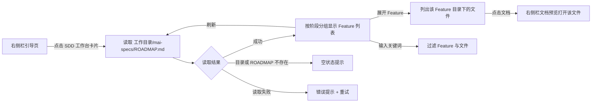

# PRD：SDD 工作台：Feature 导航与规格查看

> 状态：已评审（2026-11-20 随技术方案评审修订） | 负责人：austin | Profile：standard | 模板：`mai-specs/_templates/PRD.tmpl.md`

[返回需求简报](../BRIEF.md)

## 1. 背景与目标（Why）

- **背景/痛点**：用 my-ai-infra 做 SDD 时，Feature 的状态记录在 `mai-specs/ROADMAP.md`，规格文档分散在各 `NNN-slug/` 目录的 Markdown 文件中。查看进度或某份规格需要切到编辑器逐个打开，在 DSH 内无法完成（来源：[BRIEF](../BRIEF.md)、[素材索引](../context/_INDEX.md)）。
- **目标**：用户在 DSH Web 当前会话的右侧栏中打开“SDD 工作台”，按阶段浏览当前项目的 Feature，并直接查看任一 Feature 的规格文档，全程不离开 DSH。

## 2. 用户与场景（Who / When）

| 用户故事 ID | 目标用户 | 触发场景 | 用户故事：作为…我希望…以便… | 关联需求 |
|---|---|---|---|---|
| US-01 | 用 my-ai-infra 做 SDD 的开发者 | 在 DSH 中开发某个项目，想知道各需求进展 | 作为开发者，我希望在 DSH 里看到当前项目所有 Feature 按阶段分组的列表，以便了解整体进度，并能按关键词快速找到某个 Feature 或文件 | FR-01、FR-02、FR-03、FR-08 |
| US-02 | 同上 | 需要对照某份 PRD 或技术方案继续工作 | 作为开发者，我希望点击 Feature 下的文档就能在 DSH 中阅读它，以便不切换到编辑器 | FR-04、FR-05 |
| US-03 | 评审者/作业批改者 | 按 README 启动 DSH 检查插件 | 作为评审者，我希望按 README 命令就能启动带插件的 DSH 并使用上述功能，以便验证交付 | FR-07 |

## 3. 总体业务流程

### BF-01：浏览 Feature 并查看规格

**参与者与起止**：用户在某个已绑定工作目录的会话中，从右侧栏引导页进入；打开一份规格文档预览时结束。



**流程说明**：列表来源与分组见 BR-01、BR-02；文件清单见 BR-03；过滤见 BR-06；打开方式见 FR-05；所有操作只读（BR-04）。

## 4. 功能需求（What）

### 4.1 新增需求

| 需求编号 | 触发条件 | 输入 | 预期行为 | 输出/结果 | 关联需求编号 |
|---|---|---|---|---|---|
| FR-01 | 用户打开右侧栏引导页 | 无 | 引导页显示“SDD 工作台”入口卡片（标题、描述、图标），与“文件”等内置卡片并列 | 点击卡片在当前分栏打开 SDD 工作台页（UI-01） | US-01 |
| FR-02 | SDD 工作台页打开或刷新 | 会话工作目录；`<工作目录>/mai-specs/ROADMAP.md` | 读取 ROADMAP，解析“规划中 / 进行中 / 已完成”三个分区表格中的 Feature 行（BR-01、BR-02） | 按分区分组显示 Feature，每项显示编号、标题、优先级；分组标题显示该组数量 | US-01 |
| FR-03 | 用户点击某个 Feature 行 | Feature 行对应的目录 | 展开/收起该 Feature；展开时列出其目录下的文件（BR-03） | 文件按相对路径列出，`BRIEF.md` 排第一 | US-01、US-02 |
| FR-04 | Feature 已展开 | 文档相对路径 | 文档行显示相对 Feature 目录的路径（如 `spec/PRD.md`） | 用户能区分 PRD、技术方案、评审、测试等文档 | US-02 |
| FR-05 | 用户点击文档行 | 文档绝对路径 | 在右侧栏用现有文档预览打开该文件；同一文件已打开时切换到已有 tab | 用户看到该文件的预览（Markdown 渲染、PDF、图片等，按文档预览已有渲染器） | US-02 |
| FR-06 | 用户点击页内“刷新”按钮 | 无 | 重新读取 ROADMAP 与已展开 Feature 的文件清单，保留展开状态与过滤关键词；刷新失败时保留上次的列表并在顶部显示 COPY-14 | 列表反映磁盘上的最新内容 | US-01 |
| FR-07 | 用户按插件 README 操作 | README 中的安装、构建、启动命令 | 启动的 DSH Web 已加载本插件 | FR-01～FR-06 可实际使用 | US-03 |
| FR-08 | 用户在页头搜索框输入关键词 | 关键词 | 按 BR-06 即时过滤列表；清空关键词恢复完整列表 | 只显示匹配的 Feature 与文件；无匹配时显示 COPY-12 | US-01 |

### 4.2 变更需求

无。本需求只新增插件，不改变 DSH 现有功能的行为。

## 5. UI 视觉与交互

### UI-01：SDD 工作台页（右侧栏 tab）

**设计依据**：拟议方案线框（下图，998 为示意数据），沿用右侧栏现有页面（参照“文件”页 `packages/client/ui-sidebar-files`）的布局、间距与组件。未制作高保真稿，视觉细节在技术方案阶段按 `dsh-client-ui-ux` 规范确定。

```text
┌ [SDD 工作台] [+] ─────────────────────────┐
│ SDD 工作台                          ⟳ 刷新 │
│ [🔍 按编号、标题或文件名过滤            ] │
│ ▾ 进行中 (1)                               │
│   ▸ 998  资料检索                     P1   │
│ ▾ 规划中 (1)                               │
│   ▾ 999  SDD 工作台：Feature 导航…    P1   │
│       BRIEF.md                             │
│       context/_INDEX.md                    │
│       context/作业要求.md                  │
│       spec/PRD.md                          │
│ ▾ 已完成 (0)                               │
└────────────────────────────────────────────┘
```

| 页面区域/控件 | 新增/变更 | 对照设计的功能与交互说明 | 关联需求 |
|---|---|---|---|
| 引导页入口卡片 | 新增 | 图标（沿用 DSH 现有图标库，技术方案选定）、标题 COPY-01、描述 COPY-02；点击打开本页并替换引导页；本页已在该分栏打开时切换到已有 tab，不重复打开 | FR-01 |
| tab 标题 | 新增 | 显示 COPY-01 | FR-01 |
| 页头 | 新增 | 标题 COPY-01；右侧刷新按钮（图标按钮，可访问名称 COPY-03） | FR-06 |
| 阶段分组 | 新增 | 标题为 ROADMAP 分区名加数量（COPY-04）；可折叠，默认全部展开；空分组显示“(0)”但无子项；三个分组全部为空时不显示分组，只显示 COPY-07；ROADMAP 缺少某个分区标题时该分组按空分组处理 | FR-02 |
| Feature 行 | 新增 | 展开箭头、编号、标题（超长时沿用 DSH 现有列表的单行省略样式，悬停或键盘聚焦时显示全文）、优先级（为空时不显示）；点击或 Enter/Space 切换展开与收起 | FR-02、FR-03 |
| 搜索框 | 新增 | 占位文字 COPY-11；输入即过滤（BR-06）；Escape 清空 | FR-08 |
| 文件行 | 新增 | 显示相对路径；点击或 Enter 打开预览 | FR-04、FR-05 |

**状态与反馈**：

| 状态 | 触发条件 | 显示 | 恢复路径 |
|---|---|---|---|
| 加载中 | 首次读取或刷新进行中 | 首次读取时列表区域显示加载指示；刷新时保留当前列表；两种情况下刷新按钮均禁用 | 自动结束 |
| 无工作目录 | 当前会话没有工作目录 | COPY-05 | 切换到有工作目录的会话 |
| 未初始化 | `mai-specs/` 或 `ROADMAP.md` 不存在 | COPY-06 | 在项目中初始化 my-ai-infra 后点刷新 |
| 无 Feature | ROADMAP 存在但三个分区都没有 Feature 行 | COPY-07 | 创建 Feature 后点刷新 |
| 读取失败 | 首次读取 ROADMAP 出错（权限、IO、不是普通文件、无法解码等） | 整页显示 COPY-08，并显示刷新按钮 | 点刷新重试 |
| 刷新失败 | 列表已显示后再次读取 ROADMAP 出错 | 保留上次的列表，顶部显示 COPY-14 | 点刷新重试；成功后提示消失 |
| Feature 目录缺失 | ROADMAP 有该行，但目录不存在或位于 `mai-specs/` 之外 | 展开后显示 COPY-09 | 修正目录或 ROADMAP 后刷新 |
| 目录读取失败 | 目录存在但无法列出（无权限、IO 错误、不是目录等） | 展开后显示 COPY-13 | 修复后点刷新 |
| 目录为空 | Feature 目录下没有文件 | 展开后显示 COPY-10 | 添加文件后点刷新 |
| 文件打开失败 | 点击时文件已删除或无法读取 | 由文档预览显示其已有的文件状态与错误提示；工作台列表不变 | 刷新列表 |
| 无匹配 | 过滤关键词没有匹配任何 Feature 或文件 | COPY-12 | 修改或清空关键词 |

**可访问性**：分组和 Feature 行使用树形结构语义，支持键盘上下移动、Enter/Space 展开与收起、Enter 打开文档；刷新按钮有可访问名称。

## 6. 业务规则与约束（Rules）

| 规则 ID | 业务规则、状态流转、权限或数据约束 | 关联需求 |
|---|---|---|
| BR-01 | 数据根为当前会话工作目录下的 `mai-specs/`；不读取工作目录之外的路径，不提供配置固定目录 | FR-02 |
| BR-02 | Feature 列表以 `ROADMAP.md` 为唯一来源：只识别“规划中”“进行中”“已完成”三个二级标题下的表格；每行取“需求”列为编号、“标题”列链接文字为标题、“优先级”列为优先级；Feature 目录为标题列中第一个相对路径链接的目标文件的父目录（my-ai-infra 生成的链接指向 `NNN-slug/BRIEF.md`），相对 `ROADMAP.md` 所在目录解析。兼容新五列（需求、标题、规格、优先级、说明）与旧四列（需求、标题、优先级、说明）表头。未登记在 ROADMAP 中的目录不显示。分组顺序固定为进行中、规划中、已完成；组内按编号从小到大排列（my-ai-infra 倒序分配编号，最新的 Feature 在最上面）：纯数字编号按数值比较，非数字编号排在所有数字编号之后并按码点顺序排列，编号相同的行保持 ROADMAP 中的先后。编号重复的行按原样逐行显示，不合并。分区标题缺失、标题下没有表格或表头无法识别时，该分区视为空 | FR-02 |
| BR-03 | Feature 文件清单为该 Feature 目录下（含子目录）的所有文件，包括 Markdown、PDF、图片等素材，按相对路径的码点顺序排列（不随界面语言变化），`BRIEF.md` 置顶；以 `.` 开头的文件和目录（含其下全部内容）不列出。预览方式由文档预览按扩展名决定，无专用渲染器的类型以纯文本显示 | FR-03、FR-04、FR-05 |
| BR-04 | 只读：插件不创建、修改、删除、移动任何文件，不更改 ROADMAP 或 BRIEF 状态 | 全部 |
| BR-05 | 无法解析的 ROADMAP 行跳过，不影响其他行显示：缺编号、缺标题，或标题列没有相对路径链接（纯文本、URL、绝对路径、锚点）。Feature 目录必须位于 `mai-specs/` 之下：解析到 `mai-specs/` 之外的目录（包括工作目录之外）不读取，该行显示，展开时按目录缺失处理 | FR-02 |
| BR-06 | 过滤遵循 DSH Client 搜索规则：不区分大小写与全半角；编号与标题按子串或词首模糊匹配（如 `sdw` 匹配 “SDD Workbench”），文件相对路径只按连续子串匹配；关键词按空格拆分，每个词都须命中同一 Feature 的编号或标题，或同一文件的路径与所属 Feature 的编号、标题。编号或标题命中时显示该 Feature（展开后列出全部文件）；仅文件命中时显示该 Feature 并自动展开，只列出匹配的文件。分组顺序不变，组内按匹配度排序，匹配度相同时按 BR-02 的编号顺序。过滤会读取尚未展开的 Feature 的文件清单。分组标题数量改为匹配数，无匹配的分组隐藏。不搜索文件正文 | FR-08 |

| 非功能 ID | 性能、可靠性、安全或可访问性要求 | 适用条件与验证口径 |
|---|---|---|
| NFR-01 | 界面文案通过 DSH 本地化字典提供中文与英文，英文用句首大写；按仓库要求同时提供其余 6 种发布语言（ja、es、fr、de、ru、pt），由 AI 翻译，不在本需求验收范围 | `verify-client-ui-i18n` 门禁通过 |
| NFR-02 | 遵守工作区访问限制：所有读取经 Host 现有工作区文件接口，路径限制在会话工作目录内 | 单元测试覆盖越界路径被拒绝 |
| NFR-03 | 插件以独立包提供，不修改 agent-loop 等核心包行为 | 代码评审核对改动范围 |

## 7. 范围与边界（Scope）

- **包含**：FR-01～FR-08。
- **不包含**：流程阶段启动（调用 my-ai-infra Skill）；专门的验收结果展示（通过/失败统计、状态标记），但验收文档本身可作为普通规格文档查看；任何文档编辑或状态变更；BRIEF 中 Phase 字段的读取与显示；文件变化自动刷新；文件正文的全文搜索。
- **依赖**：DSH Web 右侧栏 tab 注册表（`ctx.sidebarRightTabs`）与引导页；右侧栏文档预览（`dsh-client-ui-sidebar-documentpreview`）；Host 工作区文件读取能力；目标项目已有符合 my-ai-infra 规范的 `mai-specs/`。

## 8. 研发资源

| 资源 ID | 类型 | 实际链接/路径或本文位置 | 用途/关联需求 | 确认与核验状态 |
|---|---|---|---|---|
| RES-01 | 演示数据 | 本仓库 `mai-specs/`（含本 Feature 999） | 开发与验收的真实数据 | 已存在 |
| RES-02 | 参照实现 | `packages/client/ui-sidebar-files`（右侧栏页 + 引导入口） | UI-01 布局与注册方式参照 | 已阅读 README |
| RES-03 | 复用组件 | `packages/client/ui-sidebar-documentpreview` | FR-05 文档预览 | 已阅读 README |

### 最终文案

| 文案 ID | 位置/触发状态 | 最终文字（中文） | 最终文字（英文） | 变量与格式规则 |
|---|---|---|---|---|
| COPY-01 | 入口卡片标题、tab 标题、页头 | SDD 工作台 | SDD workbench | — |
| COPY-02 | 入口卡片描述 | 浏览 mai-specs 中的需求与规格 | Browse features and specs in mai-specs | — |
| COPY-03 | 刷新按钮可访问名称/提示 | 刷新 | Refresh | — |
| COPY-04 | 分组标题 | {section} ({count}) | {section} ({count}) | {section} 为分区名，取 ROADMAP 原文；英文界面同样显示原文分区名；数量为整数，0 也显示 |
| COPY-05 | 无工作目录 | 当前会话没有工作目录 | This session has no working directory. | — |
| COPY-06 | 未初始化 | 未找到 mai-specs/ROADMAP.md。请先在项目中初始化 my-ai-infra | mai-specs/ROADMAP.md not found. Set up my-ai-infra in this project first. | — |
| COPY-07 | 无 Feature | ROADMAP 中还没有需求 | No features in ROADMAP yet. | — |
| COPY-08 | 读取失败 | 无法读取 ROADMAP：{reason} | Couldn't read ROADMAP: {reason} | {reason} 为 Host 返回的错误信息 |
| COPY-09 | Feature 目录缺失 | 未找到需求目录 {path} | Feature folder {path} not found | {path} 为 ROADMAP 中该行链接的原文 |
| COPY-10 | 目录为空 | 没有文件 | No files | — |
| COPY-11 | 搜索框占位文字与可访问名称 | 按编号、标题或文件名过滤 | Filter by number, title, or file name | — |
| COPY-12 | 无匹配 | 没有匹配的需求或文件 | No matching features or files | — |
| COPY-13 | 目录读取失败 | 无法读取需求目录：{reason} | Couldn't read feature folder: {reason} | {reason} 为 Host 返回的错误信息 |
| COPY-14 | 刷新失败 | 刷新失败：{reason}。显示的是上次的结果 | Refresh failed: {reason}. Showing the previous results. | {reason} 为 Host 返回的错误信息 |

## 9. 验收标准（Acceptance Criteria）

### AC-01：入口可见并可打开

**关联**：FR-01、FR-07

- **Given**：按插件 README 命令启动 DSH Web，打开一个工作目录为本仓库的会话
- **When**：展开右侧栏并查看引导页，点击“SDD 工作台”卡片
- **Then**：引导页显示带图标的 COPY-01/COPY-02 卡片（使用引导页默认占位图标即满足）；点击后当前分栏打开 SDD 工作台页，tab 标题为 COPY-01；在已打开工作台页的分栏再次从引导页进入时，切换到已有 tab，不新增 tab
- **验证方式**：人工步骤（录屏或截图），并有组件测试覆盖注册

### AC-02：按阶段分组显示 Feature

**关联**：FR-02、BR-02、BR-05

- **Given**：（单元测试构造数据）ROADMAP 的三个分区分别含若干 Feature 行，行序与编号顺序不同且含非数字编号，含五列与四列两种表头，并含缺标题、标题无链接、链接为 URL 的无效行，以及一个缺失的分区标题
- **When**：解析该 ROADMAP
- **Then**：分组顺序为进行中、规划中、已完成，组标题数量等于有效行数；每行的编号、标题、优先级、Feature 目录与 ROADMAP 一致，组内按 BR-02 的编号顺序排列；无效行被跳过；缺失的分区为空分组
- **验证方式**：解析逻辑单元测试；另用本仓库真实 ROADMAP 人工核对：分组、各组数量与 Feature 999 所在分区与验收时的 ROADMAP 一致

### AC-03：展开 Feature 列出文档

**关联**：FR-03、FR-04、BR-03

- **Given**：Feature 999 目录含 `BRIEF.md`、`context/_INDEX.md`、`context/作业要求.md`、`spec/PRD.md`，并额外放入一个 PNG 图片和一个 PDF 文件（验收用样例）
- **When**：点击 Feature 999 行
- **Then**：展开后列出该目录下全部非隐藏文件的相对路径，与验收时按 BR-03 生成的预期清单逐项一致（`BRIEF.md` 在第一位，其余按路径排序）；点击 PNG 与 PDF 能在文档预览中正常显示；再次点击 Feature 行收起
- **验证方式**：单元测试 + 人工核对

### AC-04：打开文档预览

**关联**：FR-05

- **Given**：Feature 999 已展开
- **When**：点击 `spec/PRD.md`
- **Then**：右侧栏以文档预览打开该文件，预览使用 Markdown 渲染器（标题、表格以格式化样式显示，而非原文）；再次点击同一文档切换到已打开的 tab，不重复打开。Mermaid、相对链接等渲染细节以文档预览自身能力为准，不属于本插件验收范围
- **验证方式**：人工步骤（录屏）；打开调用参数有组件测试

### AC-05：刷新反映磁盘变化

**关联**：FR-06

- **Given**：SDD 工作台页已打开，Feature 999 已展开
- **When**：在磁盘上为 Feature 999 新增一个 `.md` 文件，并在 ROADMAP 新增一行 Feature，然后点击刷新
- **Then**：新 Feature 出现在其所在分区、按 BR-02 编号顺序对应的位置；新文件按 BR-03 的排序位置出现在 Feature 999 下；Feature 999 保持展开
- **验证方式**：人工步骤；单元测试覆盖刷新保留展开状态与刷新失败保留旧列表（COPY-14）

### AC-06：空状态与错误状态

**关联**：UI-01 状态表、BR-01

- **Given**：分别为（a）会话无工作目录；（b）工作目录下无 `mai-specs/ROADMAP.md`；（c）ROADMAP 无 Feature 行；（d）ROADMAP 有行但目录不存在；（e）首次读取 ROADMAP 失败；（f）Feature 目录无法列出；（g）列表已显示后刷新失败
- **When**：打开 SDD 工作台页（d、f 为展开该 Feature；g 为点击刷新）
- **Then**：分别显示 COPY-05、COPY-06、COPY-07、COPY-09、COPY-08、COPY-13、COPY-14；文案中的变量按第 8 节规则填入（COPY-09 为链接原文，COPY-08/13/14 含 Host 返回的错误信息）；（e）（g）点刷新可重试，（g）保留旧列表
- **验证方式**：单元/组件测试覆盖 a～g；人工抽查 b

### AC-07：只读与路径限制

**关联**：BR-01、BR-04、NFR-02

- **Given**：插件正常使用；ROADMAP 中一行链接指向 `../../outside/BRIEF.md`（工作目录之外），另一行指向 `../src/BRIEF.md`（工作目录之内、`mai-specs/` 之外）
- **When**：执行 AC-01、AC-02、AC-03、AC-04、AC-06、AC-09 的插件操作（AC-05 中验收者手工改动的文件不计入）
- **Then**：插件自身不创建、修改、删除任何文件；越界行展开时不发出读取请求，显示 COPY-09
- **验证方式**：单元测试确认插件只调用 Host 的读取类接口（列目录、读文件），越界路径不发出请求；代码评审核对无写入调用；人工验证在测试数据准备完成后记录 `git status --ignored` 快照，插件操作结束后再记录一次，两份快照一致

### AC-08：双语文案

**关联**：NFR-01

- **Given**：DSH 界面语言分别为中文和英文
- **When**：打开引导页与 SDD 工作台页
- **Then**：页面直接可见的 COPY-01、COPY-02、COPY-03、COPY-11 与第 8 节逐字一致；状态文案由 AC-06、AC-09 覆盖
- **验证方式**：单元测试比对中英文字典与 COPY 表全部条目逐字一致；`verify-client-ui-i18n` 门禁确认文案走字典；人工切换语言抽查

### AC-09：搜索过滤

**关联**：FR-08、BR-06

- **Given**：SDD 工作台页显示本仓库 `mai-specs` 的完整列表
- **When**：依次输入（a）`999`；（b）`prd`（大写小写均试）；（c）`不存在的词`；（d）清空搜索框
- **Then**：（a）只显示 Feature 999；（b）显示含 `spec/PRD.md` 的 Feature 并自动展开，只列出匹配文件；（c）显示 COPY-12；（d）恢复完整列表与原展开状态
- **验证方式**：过滤逻辑单元测试；人工操作抽查

## 待确认事项

| 问题/假设 | 来源 | 影响的编号/范围 | 是否阻塞 | 决策人/状态 |
|---|---|---|---|---|
| 数据根取当前会话工作目录 | 用户决策 2026-11-18 | BR-01 | 否 | austin / 已确认 |
| 文档复用现有右侧栏文档预览打开 | 用户决策 2026-11-18 | FR-05 | 否 | austin / 已确认 |
| 列表显示编号、标题、优先级并按 ROADMAP 分区分组，不读 BRIEF Phase | 用户决策 2026-11-18 | FR-02、BR-02 | 否 | austin / 已确认 |
| 文件清单包含 PDF、图片等全部文件；搜索为列表过滤，不做全文搜索；不设成功指标 | 用户评审 2026-11-19 | BR-03、FR-08、BR-06、第 1 节 | 否 | austin / 已确认 |
| 刷新失败保留旧列表并提示（COPY-14）；删除刷新快捷键；新增 COPY-13、COPY-14 | PRD 评审 2026-11-19（[评审记录](../review/prd_review.md)） | FR-06、UI-01、AC-05、AC-06 | 否 | austin / 已确认 |
| 符号链接指向工作目录之外时是否被 Host 拒绝 | PRD 评审 2026-11-19 | BR-01、NFR-02 | 否 | 已核验：Host 拒绝（见[技术方案](../design/TECH_DESIGN.md)） |
| Feature 目录限定在 `mai-specs/` 之下 | 用户决策 2026-11-20（技术方案评审前） | BR-05、AC-07 | 否 | austin / 已确认 |
| 过滤遵循 DSH Client 搜索规则（模糊匹配、多词、按匹配度排序） | 方案评审 F2，用户决策 2026-11-20（[评审记录](../review/design_review.md)） | BR-06 | 否 | austin / 已确认 |
| 插件以独立包挂载在哪个 bundle/profile，以及 README 启动命令形式 | 本 PRD 起草 | FR-07 | 否 | 已在[技术方案](../design/TECH_DESIGN.md)决定，加载方式已由 T1 验证 |
| 文档预览能否通过 Host 读取任意工作区内 `.md`（假设可以，与“文件”页一致） | 代码调研（README） | FR-05 | 否 | 已核验：可以（见[技术方案](../design/TECH_DESIGN.md)） |

## 变更记录

| 日期 | 变更及依据 | 影响的编号/范围 |
|---|---|---|
| 2026-11-18 | 初稿：依据 BRIEF、素材索引与用户三项决策 | 全部 |
| 2026-11-19 | 用户评审：文件清单包含 PDF、图片等全部文件；新增列表过滤搜索（不含全文搜索）；删除成功指标 | BR-03、FR-03～FR-06、FR-08、BR-06、AC-03、AC-09、COPY-10～12、第 1、7 节 |
| 2026-11-19 | 处理独立 PRD 评审（[评审记录](../review/prd_review.md)）：修正 AC-05/AC-07 矛盾与只读验证方式；明确 Feature 目录解析、无效行、空分组、刷新失败、目录读取失败、重复打开；删除刷新快捷键；AC-01/02/04～08 改为可判定 | FR-06、UI-01、BR-02、BR-05、COPY-09/13/14、AC-01～AC-08 |
| 2026-11-20 | 技术方案评审前用户决策：Feature 目录限定在 `mai-specs/` 之下；同步技术方案核验结论 | BR-05、UI-01 状态表、AC-07、第 9 节 |
| 2026-11-20 | 处理技术方案评审（[评审记录](../review/design_review.md)）：过滤改用 DSH Client 搜索规则（F2）；补充其余 6 种发布语言说明（F3）；文案占位符改用英文名，界面显示不变（F7） | BR-06、NFR-01、COPY-04/08/09/13/14 |
| 2026-11-21 | 编写业务测试计划时发现验收标准不可判定，用户确认修订措辞（不改变功能）：文件数与分区计数改为与验收时实际数据比对；占位图标满足 AC-01；只读验证改为造数后快照比对；排序明确为码点顺序，隐藏目录同样不列出 | BR-03、AC-01、AC-02、AC-03、AC-07 |
| 2026-11-21 | 用户决策：Feature 列表组内改按编号从小到大排列，使最新的 Feature 在最上面（原为保持 ROADMAP 行顺序）；过滤时匹配度相同按编号顺序 | BR-02、BR-06、AC-02、AC-05 |
| 2026-11-21 | 用户决策：中文提示按仓库 UI 规范（不超过两句时句末不加句号）去掉句末“。”；英文不变 | COPY-05、COPY-06、COPY-07、COPY-14 |
